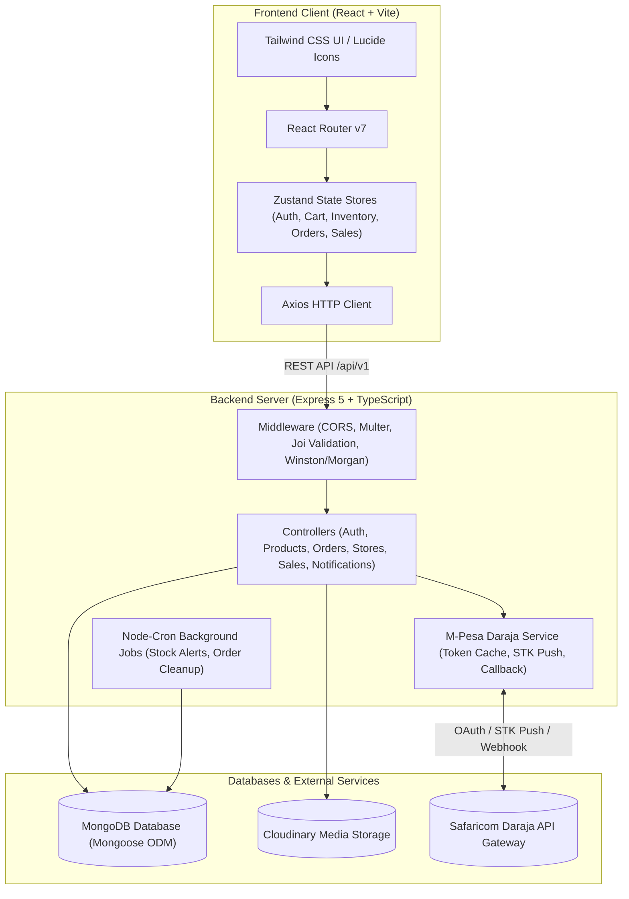
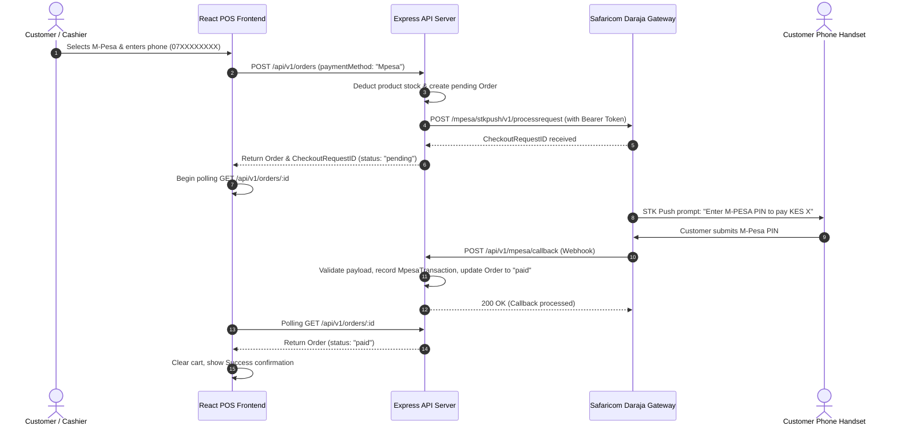

# 🍞 Golden Crust Bakery - Full-Stack POS & Inventory System

[](https://www.typescriptlang.org/)
[](https://react.dev/)
[](https://vitejs.dev/)
[](https://tailwindcss.com/)
[](https://nodejs.org/)
[](https://expressjs.com/)
[](https://www.mongodb.com/)
[](https://developer.safaricom.co.ke/)
[](https://cloudinary.com/)

An enterprise-ready, full-stack Point of Sale (POS), raw ingredient inventory tracking, store-to-kitchen/shop transfer management, sales analytics, and automated mobile payment application tailored for bakery operations. 

The system provides cashier sales workflows, automated **Safaricom Daraja M-Pesa STK Push** payment collection, Cloudinary-backed product management, stock monitoring cron jobs, and comprehensive sales reporting.

---

## 📋 Table of Contents

- [System Architecture](#-system-architecture)
- [Key Features](#-key-features)
- [Tech Stack](#-tech-stack)
- [Repository Structure](#-repository-structure)
- [Environment Variables](#-environment-variables)
- [Getting Started & Installation](#-getting-started--installation)
  - [Prerequisites](#prerequisites)
  - [Backend Setup](#1-backend-setup)
  - [Frontend Setup](#2-frontend-setup)
  - [Seeding Initial Admin User](#3-seeding-initial-admin-user)
- [M-Pesa STK Push Payment Flow](#-m-pesa-stk-push-payment-flow)
- [API Reference](#-api-reference)
  - [Authentication](#authentication-apiv1auth)
  - [Products](#products-apiv1products)
  - [Store & Raw Inventory](#store--raw-inventory-apiv1stores)
  - [Orders](#orders-apiv1orders)
  - [Sales & Reporting](#sales--reporting-apiv1sales)
  - [Notifications](#notifications-apiv1notifications)
  - [M-Pesa](#m-pesa-apiv1mpesa)
- [Database Models & Schema](#-database-models--schema)
- [Production Deployment](#-production-deployment)
- [Troubleshooting & FAQs](#-troubleshooting--faqs)

---

## 🏛 System Architecture



---

## ✨ Key Features

### 🛒 1. Point of Sale (POS) & Sales Terminal
- **Fast Product Selection:** Browse baked goods categorized by type with search capabilities and visual card layouts.
- **Cart Management:** Dynamic item quantity adjustment, real-time total and subtotal calculation, and instant stock availability checks.
- **Dual Payment Methods:**
  - **Cash:** Instant order settlement and receipt recording.
  - **M-Pesa STK Push:** Integrated mobile money checkout with Kenyan phone number normalization (`07...`, `7...`, `254...`).
- **Interactive Checkout Modal:** Live payment status monitoring (`idle`, `processing`, `waiting`, `success`, `timeout`, `cancelled`, `failed`) with automatic polling.

### 📲 2. Safaricom Daraja M-Pesa Integration
- **STK Push (Lipa Na M-Pesa Online):** Directly triggers an instant payment prompt on the customer's phone.
- **In-Memory Token Caching:** Automatically fetches, caches, and refreshes OAuth access tokens based on expiration headers.
- **Idempotent Webhook Handler:** Secure callback processor at `/api/v1/mpesa/callback` that prevents duplicate processing, matches transactions by `CheckoutRequestID` or `AccountReference`, masks sensitive phone numbers in logs, and automatically marks orders as `paid`.
- **Automated Order Timeout Cleanup:** Cron task runs every 5 minutes to mark abandoned M-Pesa orders (> 15 minutes old) as `timeout`.

### 📦 3. Raw Ingredient & Store Inventory Management
- **Ingredient Tracking:** Manage raw materials (flour, sugar, yeast, milk, etc.) with custom quantities and units (`kg`, `g`, `liters`, `units`).
- **Internal Stock Transfers:** Transfer ingredients from the main store/warehouse directly to the **Kitchen** or **Shop**.
- **Audit Log:** Automatically records transfer history with timestamps, item names, quantities, and destinations.

### 🍰 4. Product Catalog & Media Management
- **Product Details:** Manage catalog items with name, description, unit price, category, and available stock.
- **Cloudinary Image Streaming:** Upload product photos via `multipart/form-data`; images are streamed straight to Cloudinary without persisting temporary files to disk.
- **Atomic Stock Deductions:** Stock is automatically deducted when orders are placed.

### 📊 5. Business Intelligence & Reports
- **Visual Analytics:** Interactive dashboards powered by **Chart.js** displaying revenue trends, sales quantities, and order counts.
- **Timeframe Filtering:** Query performance metrics across **Daily**, **Weekly**, and **Monthly** intervals.
- **Product Breakdown:** Identify top-selling items and revenue generated per product.
- **Expense Tracking:** Monitor raw ingredient expenditures across inventory items.

### 🔔 6. Automated Background Tasks & Notifications
- **Low Stock Alerts:** Automated cron job checks stock levels every 10 minutes (`Africa/Nairobi` timezone). Items falling below threshold (< 5 units) generate unread alerts.
- **Notification Feed:** View unread alerts in the dashboard with one-click "mark as read" capability.

### 🔐 7. Authentication, RBAC & Validation
- **Role-Based Permissions:** Distinct capabilities for `admin` and `attendant` (cashier).
- **Security:** Passwords encrypted using **bcryptjs** (10 salt rounds); API sessions authenticated using **JWT**.
- **Input Validation:** Strict request sanitization using **Joi** schemas across all incoming payloads and file uploads.
- **Observability:** Centralized logging with **Winston** (console colorization + `error.log` file) combined with **Morgan** HTTP traffic logging.

---

## 🛠 Tech Stack

### Frontend Client
| Technology | Version | Purpose |
| :--- | :--- | :--- |
| **React** | `18.2.0` | UI component library |
| **Vite** | `7.0.4` | Build tool and fast HMR development server |
| **TypeScript** | `5.8.3` | Type safety and client interfaces |
| **Tailwind CSS** | `4.1.11` | Utility-first styling |
| **Zustand** | `5.0.6` | Lightweight, persisted global state management |
| **React Router** | `7.6.3` | Client-side routing and navigation |
| **Chart.js / react-chartjs-2**| `4.5.0` / `5.3.0` | Analytics visualization and interactive charts |
| **Lucide React** | `0.344.0` | Modern UI icon set |
| **Axios** | `1.10.0` | HTTP client with automatic auth token interceptors |

### Backend API
| Technology | Version | Purpose |
| :--- | :--- | :--- |
| **Node.js** | `>= 18.0.0` | JavaScript server runtime |
| **Express.js** | `5.1.0` | Core REST API framework |
| **TypeScript** | `5.8.3` | Strongly-typed backend codebase |
| **MongoDB & Mongoose** | `8.16.2` | Document database and object data modeling (ODM) |
| **Joi** | `17.13.3` | Schema definition and input validation middleware |
| **JSONWebToken (JWT)** | `9.0.2` | Stateless authentication tokens |
| **bcryptjs** | `3.0.2` | Cryptographic password hashing |
| **Multer & Cloudinary** | `2.0.1` / `2.7.0` | Multipart file upload and cloud image storage |
| **Node-Cron** | `4.2.1` | Scheduled background maintenance and alert tasks |
| **Winston & Morgan** | `3.17.0` / `1.10.0` | Application event and HTTP access logging |

---

## 📁 Repository Structure

```
sugar/
├── backend/
│   ├── src/
│   │   ├── config/              # Configuration services
│   │   │   ├── cloudinary.ts    # Cloudinary SDK credentials & config
│   │   │   ├── db.ts            # MongoDB connection establishment
│   │   │   └── logger.ts        # Winston logger & Morgan HTTP stream setup
│   │   ├── controllers/         # Request handling & business logic
│   │   │   ├── auth.controller.ts
│   │   │   ├── Notification.controller.ts
│   │   │   ├── order.controller.ts
│   │   │   ├── product.controller.ts
│   │   │   ├── sales.controller.ts
│   │   │   └── store.controller.ts
│   │   ├── middleware/          # Express middlewares
│   │   │   ├── multer.ts        # Multer memory storage configuration
│   │   │   └── validation.middleware.ts # Joi request validation schemas
│   │   ├── models/              # Mongoose data schemas
│   │   │   ├── auth.model.ts
│   │   │   ├── mpesa.models.ts
│   │   │   ├── notification.model.ts
│   │   │   ├── order.model.ts
│   │   │   ├── product.model.ts
│   │   │   ├── store.model.ts
│   │   │   └── transferHistory.model.ts
│   │   ├── routes/              # Express API route declarations
│   │   │   ├── auth.routes.ts
│   │   │   ├── mpesa.routes.ts
│   │   │   ├── notification.routes.ts
│   │   │   ├── order.routes.ts
│   │   │   ├── product.routes.ts
│   │   │   ├── sales.routes.ts
│   │   │   └── store.routes.ts
│   │   ├── scripts/             # Utility and standalone scripts
│   │   │   ├── admin.ts         # Script to seed initial administrator user
│   │   │   └── cron.ts          # Scheduled tasks (stock alerts & order timeouts)
│   │   ├── services/            # Third-party integrations & payment services
│   │   │   ├── callBack.ts      # Safaricom Daraja STK callback webhook handler
│   │   │   ├── mpesaController.ts # STK push request dispatcher
│   │   │   └── token.ts         # Daraja OAuth token generator with caching
│   │   ├── utils/
│   │   │   └── jwt.ts           # Token creation and verification helpers
│   │   └── index.ts             # Application entrypoint & server bootstrap
│   ├── .env.example             # Backend environment template
│   ├── package.json
│   └── tsconfig.json
│
├── frontend/
│   ├── public/                  # Static assets
│   ├── src/
│   │   ├── assets/              # Logos and SVGs
│   │   ├── components/          # Reusable UI components
│   │   │   ├── AddItem.tsx      # Modal to add raw store ingredients
│   │   │   ├── AddProduct.tsx   # Modal to add products with image upload
│   │   │   ├── Button.tsx       # Standard styled button
│   │   │   ├── Cart.tsx         # Sidebar shopping cart
│   │   │   ├── CheckoutModal.tsx# Payment modal (Cash / M-Pesa STK push)
│   │   │   ├── Header.tsx       # App header with branding and user profile
│   │   │   ├── Navigation.tsx   # Responsive desktop & mobile sidebar
│   │   │   ├── PaidOrders.tsx   # Filterable view of paid transactions
│   │   │   └── ProductGrid.tsx  # Interactive product gallery
│   │   ├── pages/               # Top-level views
│   │   │   ├── Login.tsx        # Authentication page
│   │   │   ├── Managment.tsx    # Admin hub (Products, Ingredients, Orders)
│   │   │   ├── Reports.tsx      # Sales analytics & Chart.js reports
│   │   │   ├── SalesTerminal.tsx# POS checkout terminal
│   │   │   └── Transfer.tsx     # Store ingredient transfers to Kitchen/Shop
│   │   ├── services/
│   │   │   └── api.ts           # Axios client & typed backend endpoints
│   │   ├── store/               # Zustand persisted state stores
│   │   │   ├── auth.store.ts
│   │   │   ├── cart.store.ts
│   │   │   ├── inventory.store.ts
│   │   │   ├── order.store.ts
│   │   │   ├── product.store.ts
│   │   │   └── sales.store.ts
│   │   ├── types/
│   │   │   └── index.ts         # TypeScript shared interfaces
│   │   ├── utils/
│   │   │   └── cn.ts            # Tailwind classnames merger
│   │   ├── App.tsx              # Root component & route declarations
│   │   ├── index.css            # Tailwind directives & styles
│   │   └── main.tsx             # Vite React DOM entrypoint
│   ├── .env.example             # Frontend environment template
│   ├── package.json
│   ├── vite.config.ts
│   └── tsconfig.json
│
└── README.md                    # Unified project documentation
```

---

## ⚙️ Environment Variables

### Backend Configuration (`backend/.env`)

| Variable | Required | Default / Example | Description |
| :--- | :---: | :--- | :--- |
| `PORT` | No | `3000` | HTTP port where Express server listens |
| `NODE_ENV` | No | `development` | Runtime environment (`development` / `production`) |
| `API_VERSION` | Yes | `v1` | Version identifier for API routes (`/api/${API_VERSION}`) |
| `BASE_URL` | Yes | `http://localhost:3000` | Publicly reachable backend URL (used for M-Pesa callback) |
| `MONGOURI` | Yes | `mongodb://localhost:27017/sugar` | MongoDB connection connection string |
| `JWT_SECRET` | Yes | `your_secret_key` | Secret key used to sign and verify JWT tokens |
| `CONSUMER_KEY` | Yes | `(Daraja Consumer Key)` | Safaricom Daraja API application Consumer Key |
| `CONSUMER_SECRET` | Yes | `(Daraja Consumer Secret)` | Safaricom Daraja API application Consumer Secret |
| `PASS_KEY` | Yes | `(Daraja Passkey)` | Lipa Na M-Pesa Online passkey |
| `SAFARICOM_IPS` | No | `196.201.214.200,...` | Comma-separated Safaricom IP whitelist for callback verification |
| `CLOUD_NAME` | Yes | `your_cloud_name` | Cloudinary account Cloud Name |
| `CLOUD_API_KEY` | Yes | `your_api_key` | Cloudinary API Key |
| `CLOUD_SECRET_KEY` | Yes | `your_api_secret` | Cloudinary API Secret |
| `ADMIN_EMAIL` | No | `admin@goldencrust.com` | Email used by `admin.ts` to bootstrap the admin account |
| `ADMIN_PASSWORD` | No | `SecurePassword123` | Password used by `admin.ts` to bootstrap the admin account |

> [!IMPORTANT]
> The backend performs an environment verification check on startup. Missing any of `CONSUMER_KEY`, `CONSUMER_SECRET`, `PASS_KEY`, `BASE_URL`, `MONGOURI`, or `JWT_SECRET` will immediately halt server initialization.

### Frontend Configuration (`frontend/.env`)

| Variable | Required | Default / Example | Description |
| :--- | :---: | :--- | :--- |
| `VITE_API_URL` | Yes | `http://localhost:3000/api/v1` | Base URL pointing to backend API (including `/api/v1`) |

---

## 🚀 Getting Started & Installation

### Prerequisites
- **Node.js**: `v18.0.0` or higher
- **npm** or **yarn** / **pnpm**
- **MongoDB**: Local MongoDB instance or free [MongoDB Atlas](https://www.mongodb.com/atlas) cluster
- **Safaricom Daraja Account**: Register at [Safaricom Developer Portal](https://developer.safaricom.co.ke/) to obtain sandbox credentials
- **Cloudinary Account**: Register at [Cloudinary](https://cloudinary.com/) for media storage credentials

---

### 1. Backend Setup

1. Open your terminal and navigate to the backend directory:
   ```bash
   cd backend
   ```

2. Install backend dependencies:
   ```bash
   npm install
   ```

3. Create your `.env` file from the provided template:
   ```bash
   cp .env.example .env
   ```
   *Edit `.env` and provide your MongoDB URI, JWT Secret, Cloudinary credentials, and Safaricom Daraja credentials.*

4. Launch the backend in development mode:
   ```bash
   npm run dev
   ```
   *The server will start on `http://localhost:3000` (or your configured `PORT`), connect to MongoDB, and start the cron scheduler.*

---

### 2. Frontend Setup

1. Open a new terminal window and navigate to the frontend directory:
   ```bash
   cd frontend
   ```

2. Install frontend dependencies:
   ```bash
   npm install
   ```

3. Create your `.env` file from the provided template:
   ```bash
   cp .env.example .env
   ```
   *Verify that `VITE_API_URL` matches your backend URL (e.g., `http://localhost:3000/api/v1`).*

4. Start the Vite development server:
   ```bash
   npm run dev
   ```
   *The application will be accessible at `http://localhost:5173`.*

---

### 3. Seeding Initial Admin User

To bootstrap an administrator account for logging into the dashboard:

1. Ensure `ADMIN_EMAIL` and `ADMIN_PASSWORD` are defined in `backend/.env`.
2. Run the admin creation script using `ts-node`:
   ```bash
   cd backend
   npx ts-node src/scripts/admin.ts
   ```
   *Or uncomment `createAdmin();` in `backend/src/index.ts` during first startup.*
3. Login on the frontend via `http://localhost:5173` using your admin credentials.

---

## 📲 M-Pesa STK Push Payment Flow



> [!NOTE]
> During local development, Safaricom's Daraja sandbox servers need a publicly accessible HTTPS endpoint to deliver webhooks. You can expose your local server using [ngrok](https://ngrok.com/):
> ```bash
> ngrok http 3000
> ```
> Then set `BASE_URL=https://your-ngrok-subdomain.ngrok-free.app` in `backend/.env`.

---

## 📡 API Reference

All routes are prefixed with `/api/v1` (where `v1` is defined by `API_VERSION`).

### Authentication (`/api/v1/auth`)

| Method | Endpoint | Description | Auth Required |
| :--- | :--- | :--- | :---: |
| `POST` | `/api/v1/auth/register` | Register a new user (`attendant` or `admin`) | No |
| `POST` | `/api/v1/auth/login` | Authenticate user & return JWT token | No |
| `GET` | `/api/v1/auth/profile` | Retrieve profile of the logged-in user | Yes (Bearer) |
| `PUT` | `/api/v1/auth/profile` | Update profile information | Yes (Bearer) |

#### Register Payload
```json
{
  "name": "Jane Doe",
  "email": "jane@goldencrust.com",
  "password": "SecretPassword123",
  "role": "attendant"
}
```

---

### Products (`/api/v1/products`)

| Method | Endpoint | Description | Payload / Type |
| :--- | :--- | :--- | :--- |
| `GET` | `/api/v1/products` | Retrieve all products | None |
| `GET` | `/api/v1/products/:id` | Retrieve single product by ID | None |
| `POST` | `/api/v1/products` | Create a new product with image | `multipart/form-data` |
| `PUT` | `/api/v1/products/:id` | Update an existing product | `multipart/form-data` |
| `PATCH`| `/api/v1/products/:id/stock` | Adjust stock quantity directly | `{ "stock": 50 }` |
| `DELETE`| `/api/v1/products/:id` | Delete a product | None |

#### Add Product Form Fields:
- `name` (string, required)
- `description` (string, optional)
- `price` (number, required)
- `category` (string, required)
- `stock` (number, required)
- `image` (binary file, required - max 5MB, JPG/PNG/WebP)

---

### Store & Raw Inventory (`/api/v1/stores`)

| Method | Endpoint | Description | Payload |
| :--- | :--- | :--- | :--- |
| `GET` | `/api/v1/stores` | List all raw store ingredients | None |
| `GET` | `/api/v1/stores/:id` | Get raw item by ID | None |
| `GET` | `/api/v1/stores/transfers/recent` | Get 3 most recent transfers | None |
| `POST` | `/api/v1/stores` | Create a new store item | `{ "itemName": "Baking Flour", "quantity": 100, "unit": "kg" }` |
| `PUT` | `/api/v1/stores/:id` | Update store item metadata | `{ "itemName": "Baking Flour", "quantity": 80, "unit": "kg" }` |
| `PATCH`| `/api/v1/stores/:id/quantity` | Update raw item stock directly | `{ "quantity": 75 }` |
| `DELETE`| `/api/v1/stores/:id` | Delete store item | None |
| `POST` | `/api/v1/stores/:id/transfer`| Transfer stock to destination | `{ "quantity": 15, "destination": "kitchen" }` |

*Valid units: `kg`, `g`, `liters`, `units`.*  
*Valid transfer destinations: `kitchen`, `shop`.*

---

### Orders (`/api/v1/orders`)

| Method | Endpoint | Description | Payload |
| :--- | :--- | :--- | :--- |
| `GET` | `/api/v1/orders` | Retrieve all orders | None |
| `GET` | `/api/v1/orders/paid` | Retrieve list of confirmed paid orders | None |
| `GET` | `/api/v1/orders/:id` | Get single order status (polled by frontend) | None |
| `POST` | `/api/v1/orders` | Place a new order (Cash or M-Pesa STK push) | See payload below |
| `PUT` | `/api/v1/orders/:id` | Update order details | Order object |

#### Create Order Payload
```json
{
  "products": [
    {
      "product": "65b8c9d1234567890abcdef1",
      "quantity": 2
    }
  ],
  "totalAmount": 500,
  "paymentMethod": "Mpesa",
  "phoneNumber": "254712345678",
  "user": "65b8c9d1234567890abcdef0"
}
```

---

### Sales & Reporting (`/api/v1/sales`)

| Method | Endpoint | Description |
| :--- | :--- | :--- |
| `GET` | `/api/v1/sales/total-sales` | Aggregate sales summary across all products |
| `GET` | `/api/v1/sales/timeframe/:timeFrame` | Filter sales by timeframe (`daily`, `weekly`, `monthly`) |
| `GET` | `/api/v1/sales/total-sales/:productId` | Query historical sales for a specific product |
| `GET` | `/api/v1/sales/expenses` | Aggregate total inventory material costs |

---

### Notifications (`/api/v1/notifications`)

| Method | Endpoint | Description |
| :--- | :--- | :--- |
| `GET` | `/api/v1/notifications/unread` | Get active unread alerts (low product or raw stock) |
| `POST` | `/api/v1/notifications/mark-as-read` | Mark a notification as read |

---

### M-Pesa (`/api/v1/mpesa`)

| Method | Endpoint | Description |
| :--- | :--- | :--- |
| `POST` | `/api/v1/mpesa/callback` | Webhook URL registered with Safaricom Daraja STK Push |
| `GET` | `/api/v1/mpesa/transactions` | Retrieve all processed M-Pesa transaction records |

---

## 🗄 Database Models & Schema

### 1. User (`Auth`)
- `name` (String, required)
- `email` (String, required, unique)
- `password` (String, bcrypt hashed)
- `role` (String, enum: `['attendant', 'admin']`, default: `'attendant'`)

### 2. Product (`Product`)
- `name` (String, required)
- `description` (String, optional)
- `price` (Number, min: 0)
- `image` (String, Cloudinary CDN URL)
- `category` (String, required)
- `stock` (Number, min: 0)
- `createdAt` (Date)

### 3. Store Item (`Store`)
- `itemName` (String, required)
- `quantity` (Number, required)
- `unit` (String, enum: `['kg', 'g', 'liters', 'units']`)
- `stock` (Number)

### 4. Transfer History (`TransferHistory`)
- `itemId` (ObjectId -> Store)
- `itemName` (String)
- `quantity` (Number)
- `unit` (String)
- `destination` (String, enum: `['kitchen', 'shop']`)
- `transferredAt` (Date)
- `transferredBy` (String)

### 5. Order (`Order`)
- `products`: Array of `{ product: ObjectId -> Product, quantity: Number }`
- `totalAmount` (Number, min: 0)
- `paymentMethod` (String, enum: `['cash', 'Mpesa']`)
- `paymentStatus` (String, enum: `['pending', 'paid', 'failed', 'cancelled', 'timeout']`)
- `phoneNumber` (String, optional)
- `mpesaCheckoutRequestID` (String, optional)
- `mpesaReceiptNumber` (String, optional)
- `resultDesc` (String, optional)
- `createdAt` (Date)

### 6. M-Pesa Transaction (`MpesaTransaction`)
- `amount` (Number)
- `phoneNumber` (String)
- `mpesaReceiptNumber` (String)
- `checkoutRequestId` (String)
- `merchantRequestId` (String)
- `resultCode` (Number)
- `resultDesc` (String)
- `status` (String, enum: `['pending', 'success', 'failed']`)
- `order` (ObjectId -> Order)

### 7. Notification (`Notification`)
- `type` (String, enum: `['low_stock', 'new_product', 'order_received']`)
- `message` (String)
- `productId` (ObjectId -> Product, optional)
- `storeId` (ObjectId -> Store, optional)
- `read` (Boolean, default: false)
- `createdAt` (Date)

---

## 🚢 Production Deployment

### 1. Build the Backend
```bash
cd backend
npm run build
```
This compiles TypeScript files from `src/` to `dist/`. You can run the production server with:
```bash
npm start
# or using a process manager:
pm2 start dist/index.js --name "sugar-backend"
```

### 2. Build the Frontend
```bash
cd frontend
npm run build
```
This generates optimized static files inside `frontend/dist/`. These can be served using **Nginx**, **Caddy**, or static hosting providers (Vercel, Netlify, Cloudflare Pages).

### 3. Recommended Nginx Configuration
```nginx
server {
    listen 80;
    server_name bakery.yourdomain.com;

    # Serve React Frontend
    location / {
        root /var/www/sugar/frontend/dist;
        index index.html index.htm;
        try_files $uri $uri/ /index.html;
    }

    # Proxy API Requests to Backend
    location /api/ {
        proxy_pass http://localhost:3000;
        proxy_http_version 1.1;
        proxy_set_header Upgrade $http_upgrade;
        proxy_set_header Connection 'upgrade';
        proxy_set_header Host $host;
        proxy_cache_bypass $http_upgrade;
        proxy_set_header X-Real-IP $remote_addr;
        proxy_set_header X-Forwarded-For $proxy_add_x_forwarded_for;
        proxy_set_header X-Forwarded-Proto $scheme;
    }
}
```

---

## ❓ Troubleshooting & FAQs

### 1. Backend fails to start with "Missing required environment variable"
- Ensure that `backend/.env` exists and contains non-empty values for:
  `CONSUMER_KEY`, `CONSUMER_SECRET`, `PASS_KEY`, `BASE_URL`, `MONGOURI`, and `JWT_SECRET`.

### 2. M-Pesa STK push modal remains stuck on "Waiting for payment..."
- In development, Safaricom cannot reach `localhost`. You **must** supply a public HTTPS URL via ngrok or localtunnel in `BASE_URL` (e.g., `BASE_URL=https://abc.ngrok-free.app`).
- Confirm that the customer's phone number begins with `2547...` or valid Safaricom test numbers.

### 3. Product creation fails with "image required" or Cloudinary upload error
- Products require an image file attached with field key `image`.
- Verify your `CLOUD_NAME`, `CLOUD_API_KEY`, and `CLOUD_SECRET_KEY` in `backend/.env`.

### 4. CORS errors in the browser console
- Verify that `VITE_API_URL` in `frontend/.env` points to the running backend port.
- If running across custom domains, ensure `cors()` in `backend/src/index.ts` is configured to allow your frontend origin.

---

## 📄 License

This project is licensed under the [ISC License](backend/package.json).
